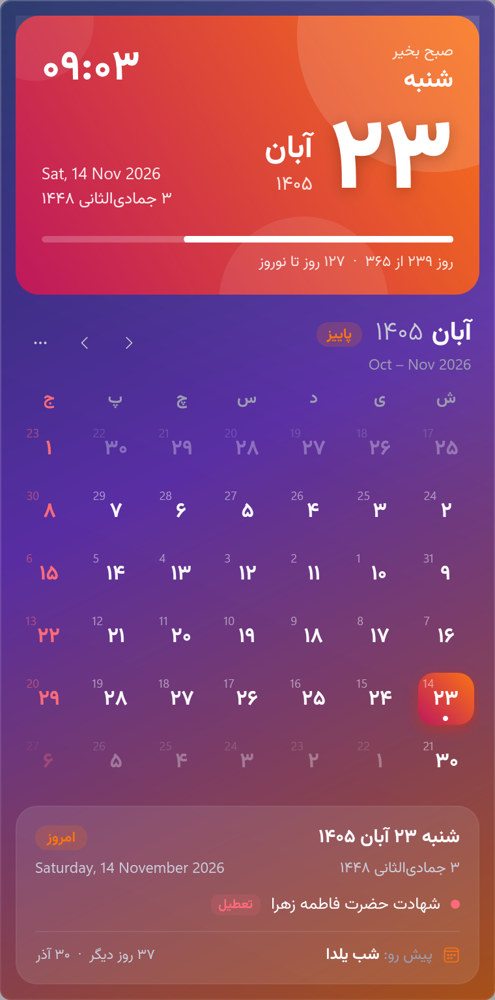
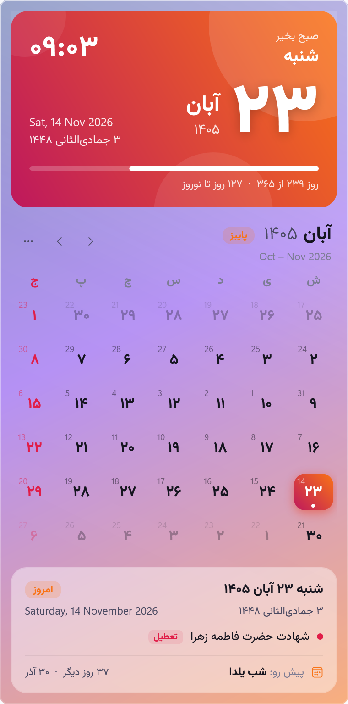
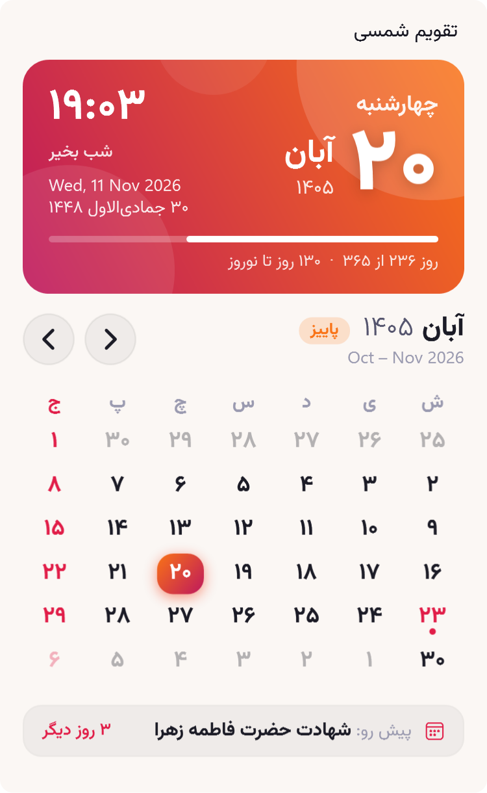

# تقویم شمسی · Persian Calendar Widget for Windows 11

A Persian (Solar Hijri / Jalali) calendar for Windows 11, built with **.NET 11** and **C# 14/preview**. It comes in two forms that share one calendar engine:

| | What it is | Where it lives |
|---|---|---|
| **Desktop widget** (`PersianCalendar.Desktop`) | A frameless WPF window with a live clock, the full month and occasions. It uses the native Windows 11 acrylic backdrop | On your desktop: pinned under other windows, always on top, or a normal window |
| **Widgets Board provider** (`PersianCalendar.WidgetProvider`) | An official Windows 11 widget in small, medium and large sizes, drawn in the same style and Vazirmatn font as the desktop widget | `Win + W` → **+** → «تقویم شمسی» |

<p align="center">
  
  &nbsp;
  
  &nbsp;
  
</p>

## Features

- **Today at a glance**: weekday, a large Persian day number, month and year, and a live clock (seconds optional). A greeting changes with the time of day (صبح/ظهر/عصر/شب بخیر).
- **Three calendars**: Solar Hijri, Gregorian and lunar Hijri. Each grid cell also shows the Gregorian day number in a corner.
- **Year progress**: a bar showing «روز ۲۳۶ از ۳۶۵ · ۱۳۰ روز تا نوروز».
- **Saturday-first month grid**: Fridays and official holidays in red, an event dot on days with occasions, and a glowing highlight on today. Clicking a faded day jumps to that month.
- **Occasions**: all official Iranian holidays (solar and lunar), plus Yalda, Chaharshanbe Suri, Mehregan, Tirgan, Sadeh and the days honouring Ferdowsi, Saadi, Hafez and others. The footer always shows the next upcoming occasion with a countdown.
- **Seasonal colours**: the hero card follows today's season (spring green, summer sun, autumn ember, winter ice). The accent colour follows the season of the month you're viewing, so the colours change as you browse.
- **Glass background**: a live blur of whatever is behind the widget, with a light tint, a soft shine and a highlighted edge. It stays glassy even when the widget isn't focused (the Windows 11 acrylic backdrop turns solid then). The «پس‌زمینهٔ شیشه‌ای» menu item switches to the denser frosted acrylic look.
- **Feels native on Windows 11**: acrylic backdrop, DWM rounded corners and shadow, light/dark that follows the system, Vazirmatn font, and Fluent icons.
- **Tray icon** that always shows today's day number. Left-click shows or hides the widget; right-click opens the menu.
- **Context menu** (right-click or the `⋯` button): pinned to desktop, always on top, or normal window; theme; show seconds; show Gregorian day numbers; start with Windows; hide; exit.
- **Widgets Board sizes**: small is a date tile; medium adds the current week; large has the full month with ‹ (previous) / › (next) buttons, a «امروز» button when you browse away, and the next occasion. The Widgets host only offers its system font, so the provider draws the card parts with WPF and Vazirmatn and sends them as images. Each part comes in a dark and a light version, chosen with `$host.hostTheme`.
- **Keyboard and mouse**: `←`/`→` (previous / next) or `PgUp`/`PgDn` change month, `↑`/`↓` change year, `Home`/`T` go to today, `Esc` hides the widget. Mouse wheel changes month; Ctrl+wheel changes year. Drag the hero card to move the widget; its position is remembered.

## Requirements

- Windows 11 (22H2 or later recommended)
- [.NET 11 SDK](https://dotnet.microsoft.com/download/dotnet/11.0). `global.json` pins `11.0.100` with `rollForward: latestFeature`.
- For the Widgets Board provider:
  - **Developer Mode** (Settings → System → For developers)
  - **Windows App Runtime 2.6**. It is usually installed already; otherwise run `winget install Microsoft.WindowsAppRuntime.2.6`.

## Getting started

```powershell
# Build everything and run the tests
dotnet build PersianCalendarWidget.slnx
dotnet test  tests/PersianCalendar.Core.Tests

# Desktop widget
dotnet run --project src/PersianCalendar.Desktop

# Windows 11 Widgets Board provider (registers the MSIX for the current user)
./scripts/Install-WidgetProvider.ps1          # then: Win+W → + → «تقویم شمسی»
./scripts/Uninstall-WidgetProvider.ps1
```

In **Visual Studio 2026**, open `PersianCalendarWidget.slnx`. Set `PersianCalendar.WidgetProvider` as the startup project and press F5 to deploy and debug the widget.

### Publishing the desktop widget

```powershell
dotnet publish src/PersianCalendar.Desktop -c Release -r win-x64 --self-contained -p:PublishSingleFile=true
# → src/PersianCalendar.Desktop/bin/Release/net11.0-windows/win-x64/publish/PersianCalendarWidget.exe
```

### Building a signed MSIX for the widget provider

```powershell
dotnet publish src/PersianCalendar.WidgetProvider -c Release -p:Platform=x64 `
  -p:GenerateAppxPackageOnBuild=true -p:AppxPackageSigningEnabled=true `
  -p:PackageCertificateKeyFile=path\to\cert.pfx -p:PackageCertificatePassword=***
```

The certificate subject must match `Publisher` in `Package.appxmanifest` (`CN=PersianCalendarWidget`).

## Solution layout

```
PersianCalendarWidget.slnx          ← XML solution format (.slnx)
Directory.Build.props               ← shared settings: LangVersion=preview, nullable, analyzers
Directory.Packages.props            ← Central Package Management
global.json
src/
  PersianCalendar.Core/             ← UI-agnostic calendar engine (+ shared season colours)
    JalaliDate.cs                   ← readonly record struct over DateOnly
    HijriDate.cs                    ← Umm al-Qura + Iran adjustment
    EventCatalog.cs                 ← holidays and occasions (FrozenDictionary)
    MonthLayout.cs                  ← Saturday-first month grid
    Extensions.cs                   ← C# 14 extension members
  PersianCalendar.Desktop/          ← WPF desktop widget
    MainWindow.xaml                 ← hero card, navigation, grid, details
    ViewModels/                     ← MVVM with C# 14 `field`-backed properties
    Services/                       ← DWM backdrop, theme, tray, settings, startup
    Themes/                         ← Dark / Light palettes + control styles
  PersianCalendar.WidgetProvider/   ← Windows 11 Widgets Board provider (MSIX + COM server)
    WidgetProvider.cs               ← IWidgetProvider implementation
    CardData.cs                     ← Adaptive Card data binding
    Rendering/CardRenderer.cs       ← WPF + Vazirmatn drawing of the card parts (STA render thread)
    Templates/                      ← small / medium / large Adaptive Card templates
    Com/ClassFactory.cs             ← [GeneratedComInterface] class factory
tests/PersianCalendar.Core.Tests/   ← MSTest 4
tools/generate-assets.cs            ← file-based app: regenerates icons and images
scripts/                            ← install / uninstall the widget provider
```

## Modern .NET and C# features used

| Feature | Where |
|---|---|
| **Extension members** (`extension(T x) { … }`, C# 14) | `Core/Extensions.cs`: `DayOfWeek.PersianIndex`, `int.ToPersianDigits()`, `JalaliDate.MonthName` |
| **`field` keyword** (C# 14) | Every view-model property: `{ get; set => SetProperty(ref field, value); }` |
| **Null-conditional assignment** `a?.B = x` (C# 14) | `MainViewModel.Select`, `App.ToggleSeconds`, `WidgetProvider.Deactivate` |
| **`System.Threading.Lock`** (C# 13) | Thread-safe widget state in `WidgetProvider` |
| Collection expressions and spreads, list patterns | Throughout; `args is ["--snapshot", var path, ..]` |
| Primary constructors | `EventCatalog`, `DayCellViewModel`, `RelayCommand` |
| `TimeProvider` | Clock abstraction in the view model and the widget provider |
| `FrozenDictionary` | Holiday lookups |
| `[LibraryImport]` source-generated P/Invoke | `NativeMethods`, `Ole32` |
| `[GeneratedComInterface]` / `[GeneratedComClass]` | COM class factory for the widget host |
| `System.Text.Json` source generation | `SettingsJsonContext` |
| File-based apps (`dotnet run file.cs`, `#:package`) | `tools/*.cs` |
| `.slnx` + Central Package Management | Solution root |

## Customising

- **Holidays and occasions**: edit the `Solar` and `Lunar` tables in `src/PersianCalendar.Core/EventCatalog.cs`.
- **Lunar date adjustment**: lunar dates use the Umm al-Qura calendar shifted by `HijriDate.IranAdjustment` (−1 day), which matches Iran's official calendar for the tested dates. You can override it per user with `HijriAdjustment` in `%LOCALAPPDATA%\PersianCalendarWidget\settings.json`. Lunar holidays may still differ by a day from the final official announcement.
- **Season colours**: `ThemeService.SeasonColors` (desktop) and `tools/generate-assets.cs` (widget backgrounds).
- **Screenshots and docs**: `PersianCalendarWidget.exe --snapshot out.png [--dark|--light]` renders the widget to a PNG.
- **Inspecting the widget cards**: `PersianCalendar.WidgetProvider.exe --preview <folder>` renders every card part and a Widgets Board mock-up for each size and theme (`large-dark.png`, …), plus the data JSON. Picker screenshots in `Assets/Screenshot*.png` come from this.

## Credits

- Font: [Vazirmatn](https://github.com/rastikerdar/vazirmatn) by Saber Rastikerdar, SIL Open Font License 1.1
- Icons: Segoe Fluent Icons (Windows)
